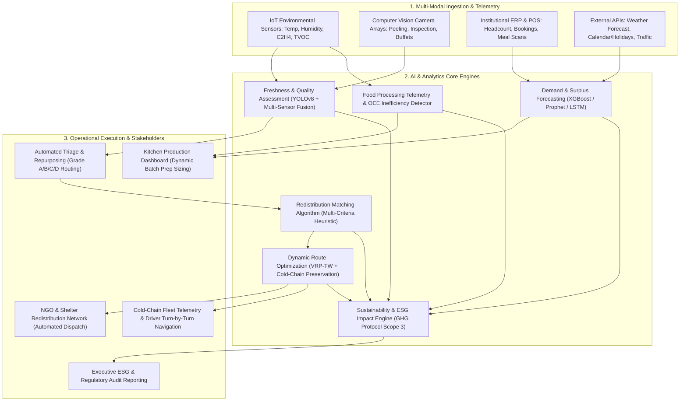

# AI-Powered Smart Food Waste Management and Redistribution Platform (FoodLoop AI)

## System Architecture & Technical Specifications

---

## Key Modules & Mathematical Formulations

### 1. AI Demand Forecasting Engine
* **Objective**: Forecast real-time meal demand $D_t$ for time window $t$ to prevent batch overproduction.
* **Formulation**:
  $$D_t = N_{\text{registered}} \times \mu_{\text{portion}} \times W_{\text{weather}}(t) \times D_{\text{dow}}(t) \times E_{\text{event}}(t)$$
  Where:
  - $N_{\text{registered}}$: Target registered headcount.
  - $\mu_{\text{portion}}$: Base consumption factor per person (kg).
  - $W_{\text{weather}}$: Weather elasticity factor (e.g., $0.85$ during heavy storms).
  - $D_{\text{dow}}$: Day of week attendance factor (e.g., $0.82$ on remote Fridays).
  - $E_{\text{event}}$: Special event / catering multiplier.
* **Safety Buffer & Staggered Cooking**: Splits batch preparation into a $60\% - 40\%$ staggered preparation schedule, allowing adjustments based on live cafeteria turnstile entry logs.

---

### 2. Multi-Modal Freshness & OpenCV Spoilage Detection
* **OpenCV Computer Vision Pipeline**:
  - **HSV Color Segmentation**: Converts incoming RGB food images to HSV space to isolate browning, senescence, and chlorophyll loss via `cv2.inRange` / `cv.inRange`.
  - **Contour Defect Extraction**: Extracts physical bruise contours and fungal spot boundaries using `cv2.findContours` and Canny edge gradients.
  - **Laplacian Texture Shrivel Variance**: Computes structural texture decay ($\text{Var}(\nabla^2 I)$) to detect dehydration and loss of turgidity in fresh produce.
* **Multi-Sensor Fusion Formula**:
  $$S_{\text{freshness}} = w_v \cdot V_{\text{OpenCV}} + w_s \cdot \left[100 - \left(P_{\text{temp}} + P_{\text{ethylene}} + P_{\text{tvoc}}\right)\right]$$
  - $w_v = 0.60$ (OpenCV Visual weight), $w_s = 0.40$ (IoT sensor telemetry weight).
  - $P_{\text{temp}}$: Penalty for thermal breach above $4^\circ\text{C}$ for cooked/dairy items.
  - $P_{\text{ethylene}}$: Senescence penalty based on $C_2H_4$ gas concentration (ppm).
  - $P_{\text{tvoc}}$: Microbial volatile organic compounds indicating bacterial growth.
* **Automated Triage Grades**:
  - **Grade A ($\ge 85$)**: Prime Quality $\rightarrow$ Kitchen prep & immediate dining.
  - **Grade B ($65-84$)**: Good Freshness $\rightarrow$ Fast-track NGO human donation.
  - **Grade C ($40-64$)**: Secondary Quality $\rightarrow$ Kitchen upcycling (purees, stocks, dehydration).
  - **Grade D ($<40$)**: Expired / Inedible $\rightarrow$ Aerobic biomass composting / biogas.

---

### 3. Commercial Surplus Marketplace & Monetization Engine (For-Profit Model)
* **Multi-Tier Revenue Architecture**:
  1. **B2C Flash-Sale Consumer App**: Sells surplus cafeteria portions directly to office workers and students at 50%–70% discount.
  2. **B2B Secondary Wholesale**: Liquidates bulk raw surplus produce and proteins to commercial ghost kitchens and caterers.
  3. **Bio-Economy Upcycling**: Sells organic trimmings and scraps to animal feed mills and anaerobic biogas digesters.
* **Platform Monetization & Commission Mechanics**:
  $$\text{Gross Order Value (GMV)} = Q_{\text{units}} \times P_{\text{dynamic}}$$
  $$\text{Platform Commission Revenue} = \text{GMV} \times 20\% \quad (\text{Take-Rate})$$
  $$\text{Seller Kitchen Net Payout} = \text{GMV} \times 80\%$$
* **Dynamic Pricing Urgency Elasticity**:
  $$P_{\text{dynamic}}(t) = P_{\text{retail}} \times \left(1 - \delta(t)\right)$$
  - $\delta(t) = 45\%$ when $t_{\text{expiry}} \ge 6\text{ hrs}$
  - $\delta(t) = 60\%$ when $3\text{ hrs} \le t_{\text{expiry}} < 6\text{ hrs}$
  - $\delta(t) = 75\%$ when $t_{\text{expiry}} < 3\text{ hrs}$ (Flash clearance)
* **Commercial Route Optimization (VRP-TW)**:
  - Optimizes commercial cold-chain courier dispatch to ghost kitchens and pickup hubs with automated invoicing.

---

### 4. Food Processing Line Telemetry & Inefficiency Detection
* **Overall Equipment Effectiveness (OEE)**:
  $$\text{OEE} = \text{Availability} \times \text{Performance} \times \text{Quality}$$
  - Identifies equipment bottlenecks (e.g., blade blunting causing high scrap rates).
  - Flags abnormal idle power consumption and temperature fluctuations.

---

### 5. Sustainability & ESG Impact Metrics
* **GHG Avoidance Formula (Scope 3 Category 5)**:
  $$E_{\text{avoided}} = \sum_{i} Q_i \times EF_i \quad (\text{kg CO}_2\text{e})$$
  - Cooked meals: $2.85 \text{ kg CO}_2\text{e}/\text{kg}$
  - Dairy/Meat: $5.70 \text{ kg CO}_2\text{e}/\text{kg}$
  - Produce: $1.45 \text{ kg CO}_2\text{e}/\text{kg}$
* **Virtual Water Saved**:
  $$W_{\text{saved}} = \sum_{i} Q_i \times WF_i \quad (\text{Liters})$$
* **Meals Provided**: $M = \frac{Q_{\text{redistributed}}}{0.4\text{ kg/meal}}$
